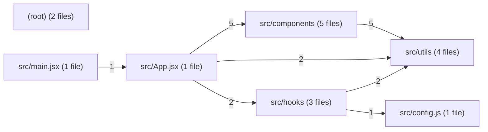

# Architecture

Grocerly is a single-page grocery list app built with React and Vite. It has 17 source files, plain JavaScript/JSX.

## Modules

| Module | Files | Responsibility |
| --- | --- | --- |
| `src/main.jsx` | 1 | React entry. Mounts `App` into `index.html` with `createRoot`, inside `StrictMode`. |
| `src/App.jsx` | 1 | Root function component. Holds the UI state (filter, search, sort, archived view, highlighted item), turns user actions into item actions, and wires up the child components. |
| `src/hooks` | 3 | `useGroceryItems` loads items from localStorage or the seed, saves them when they change, records `lastSaved`, and exposes `dispatch`. `itemsReducer` holds the list changes (`load`, `add`, `toggle`, `remove`, `clearDone`) as immutable updates. `useVisibleItems` computes the filtered, searched and sorted list. |
| `src/components` | 5 | Presentational components: `AddItemForm`, `ItemList` (also renders the archived list, through `idPrefix`/`emptyText` props), `Toolbar`, `Stats`, and `SavedLabel`, which owns the one-second tick for the "Saved … ago" text. |
| `src/utils` | 4 | `filters` (one predicate map behind `applyFilter` and `countByFilter`), `helpers` (`relative`, `categories`, `findDuplicates`, `capitalize`), `format` (`formatDate`, `formatQty`, `pluralize`, using `Intl`), and `parseQuery`, which splits the search box into plain words and field comparisons such as `qty>2`. |
| `src/config.js` | 1 | Constants: `SEED_URL`, `STORAGE_KEY`, and `DEBUG` (from `import.meta.env.DEV`). |
| (root) | 2 | `vite.config.js` and `eslint.config.js`. |

### `parseQuery`

`useVisibleItems` calls `parseQuery` on the search text. Words without `<`, `>` or `=` match item names. A comparison word is matched against an allowlist of fields (`qty`, `name`, `category`, `done`) and operators (`=`, `==`, `<`, `>`, `<=`, `>=`) and becomes a predicate. `qty` values become numbers and `done` values become booleans. Malformed words (`>5`, `qty>`) and unknown fields (`price>1`) are ignored. This replaced an `eval`-based parser (d12c53f). A single `=` now compares instead of assigning.

### Removed or changed by the runs

- `src/utils/bus.js` (the pub/sub event bus) and `src/utils/legacy.js` are gone.
- `src/components/ArchivedList` is gone. It was merged into `ItemList`.
- The hardcoded `API_KEY` is no longer exported from `src/config.js` (5346638; `src/config.test.js` pins this). The key is still in Git history and must be revoked and rotated at the provider. The app holds no secrets.
- The architecture analysis lists `public` and `.github/workflows/ci.yml` as removed. It counts 0 source files in them. `public/seed.json`, `public/style.css` and the CI workflow are still in the repository, and the app still fetches `/seed.json` (`SEED_URL`).

Tests sit next to the code they cover: `src/App.test.jsx`, `src/App.handleAdd.test.jsx`, `src/main.test.jsx`, `src/config.test.js`, `src/components/AddItemForm.test.jsx`, `src/components/ItemList.test.jsx`, `src/hooks/itemsReducer.test.js`, `src/hooks/useGroceryItems.test.js`, `src/hooks/useVisibleItems.test.js`, `src/utils/filters.test.js`, `src/utils/format.test.js`, `src/utils/helpers.test.js`, `src/utils/parseQuery.test.js`. Shared test setup is in `src/setupTests.js`. `Toolbar`, `Stats` and `SavedLabel` have no tests of their own. `App.test.jsx` covers them through the UI.

## Entry points

- `src/main.jsx`: the application.
- `vite.config.js`: build, dev server and test configuration (`npm run dev`, `npm run build`, `npm test`).
- `eslint.config.js`: lint configuration (`npm run lint`).
- `src/setupTests.js` and the test files listed above: the Vitest suite.

## Data flow

1. On mount, `useGroceryItems` reads items from localStorage (key `grocerly-items`). If it finds none, it fetches `/seed.json` with `fetch`. A non-2xx response becomes an error that `App` shows.
2. Items live in the `itemsReducer` state. User actions in `App` (add, toggle, remove, clear done) dispatch reducer actions. Filter, sort, search and the archived view are local `App` state.
3. `useVisibleItems` uses `utils/parseQuery` for the search text and `utils/filters` to build the displayed list. `App` also uses `utils/filters` for the open/done counts and `utils/helpers` for categories and duplicates.
4. `App` passes the items and callbacks down to the components. Items are added only through `AddItemForm`'s `onAdd` prop.
5. When the items change, the persist effect in `useGroceryItems` writes them back to localStorage and then sets `lastSaved`, which `SavedLabel` shows. `lastSaved` updates one render after the items change. It is also set when the seed is first written to storage, so "Saved" shows once the first load completes (2c2a054).

## Diagram

Each arrow is an import dependency, and its label counts the imports. `src/main.jsx` imports only `App`. `App` is the hub. It imports the five components, the two hooks that own the item data and the visible list, and two utils modules (filters for the counts, helpers for categories and duplicates). The components depend on `src/utils` for formatting and helpers. The hooks import two utils modules (`filters` and `parseQuery`, both used by `useVisibleItems`). They are also the only code that reads `src/config.js`, because loading and saving items happens only there. Nothing imports the (root) config files, which the tooling reads. No module imports `App` or the hooks back, so data flows in one direction from the hooks through `App` to the components.
